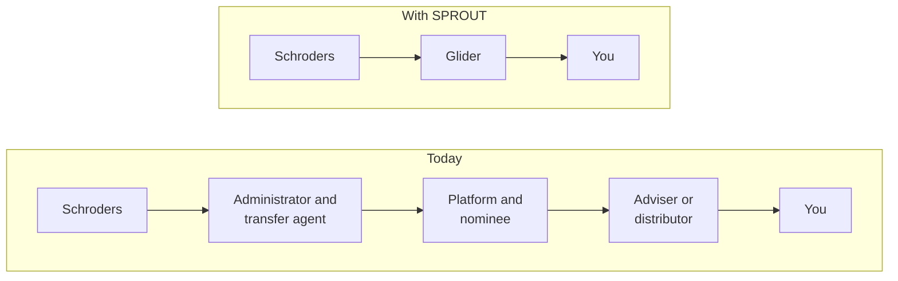
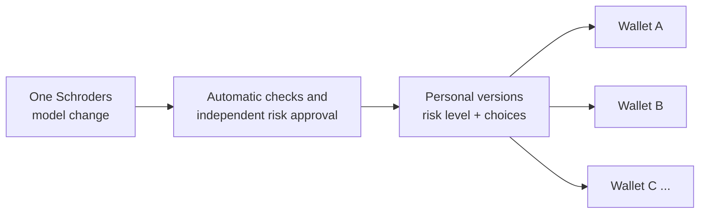

# SPROUT

**Schroders portfolios, held in your own wallet.** Powered by Glider.

SPROUT is a working prototype of a direct way to deliver active management. Schroders' investment teams run the portfolios, investors hold every position in a wallet only they control, and rebalancing happens onchain, without the usual chain of intermediaries.

Investors opt in once. After that, management is always on: one Schroders decision reaches every wallet, each kept in line with that investor's own choices.

> **Prototype.** SPROUT is for demonstration only. No real money moves, and nothing here is an offer or investment advice. See [what's real and what's simulated](#whats-real-and-whats-simulated).

## The idea

**Direct to you.** Today, an investor's money passes through several firms before it reaches them. SPROUT shortens the chain.



**At scale.** A portfolio manager changes a model once. SPROUT scales the change to each risk level, keeps each investor's own choices, and produces the right trades for each wallet.



**The Schroders range.** There are three active strategies, each with its own investment team and risk levels:

| Strategy | Purpose | What it holds |
|---|---|---|
| Schroders Quality 7 | Growth | Seven global leaders with durable earnings, weighted by Schroders' conviction |
| Schroders Global Income | Income | Dependable dividend payers, a little gold and a cash buffer |
| Schroders Sustainable Leaders | Sustainable | Companies leading the shift to cleaner energy, healthier lives and fairer finance |

Schroders Thematic Portfolios appear as previews only. They are marked "coming soon" and can't be invested in.

## Three views of one product

| View | Address | Who it's for | What you can do |
|---|---|---|---|
| **Website** | `/` | Prospective investors | Follow the story in three sections: direct to you, at scale, and the range. |
| **App** | `/app` | Investors | Sign up, pick a strategy and risk level, personalise it, fund it, and see each decision explained. |
| **Admin console** | `/console` | Schroders portfolio managers | Change a model, check and approve it, publish it, and rebalance every opted-in portfolio. |

Switch views with the button in the corner of any page, or with `Alt+1`, `Alt+2` and `Alt+3`.

## Run it locally

You need Python 3.9 or newer. There is nothing else to install, because the server uses only the standard library.

```bash
git clone https://github.com/clement-lee-eth/schroders-sprout.git
cd schroders-sprout/sprout-lab
python3 server.py
```

Then open <http://127.0.0.1:8765>. To use a different port, set `PORT`.

### Connect to Glider (optional)

Everything except the live Glider features runs without a key. To turn those on, create `.env.local` in the top folder of the repo:

```bash
GLIDER_API_KEY=your-key-here
```

`.env.local` is ignored by git. Never commit a key to this repo.

## Demo guide

- **Admin tour:** open `/console?tour=1` for a guided walk through a full model change, from the first edit to the daily rebalance.
- **Investor story:** open `/app`. Press `P` or the `⋯` button for the presenter menu, which includes **Start the story again**.
- **Reset a demo:** app and console progress is saved in your browser, so the presenter menu resets it for you only. To rebuild the server's database, run `python3 seed.py`. This also deletes any mock portfolios saved in `/lab`.

## What's real and what's simulated

| Part | Status |
|---|---|
| Share prices | **Live.** Quotes for the underlying shares from Yahoo Finance, cached for 30 seconds. |
| Asset catalogue | **Real, as a snapshot.** Assets and public strategies captured from Glider and stored in `sprout.db`. |
| "Check with Glider" | **Live, with a key.** A real dry run through `POST /v2/strategies/validate`, which creates nothing. |
| Glider status panel | **Live, with a key.** A read-only snapshot from Glider, cached for 60 seconds. |
| Pre-trade checks | **Illustrative.** SPROUT's own example rules, calculated locally. |
| Publishing and rebalancing | **Simulated.** No strategy is created and no trade is placed. |
| Investors and totals | **Illustrative.** The demo investor is Maya, and the rest of the investor base is generated. |
| Sign-up and wallet | **Simulated.** No real account or wallet is created. |

## How it's built

```text
.
├── docs/                 Glider platform limits and Privy sign-in notes
└── sprout-lab/
    ├── server.py         Pages and JSON API (Python standard library)
    ├── seed.py           Rebuilds sprout.db from data/
    ├── sprout.db         SQLite: assets, strategies, saved mock portfolios
    ├── data/             Glider catalogue snapshots and validation results
    ├── scripts/          Helpers for strategy creation and validation
    └── static/
        ├── index.html    Website
        ├── app.html      Investor app
        ├── console.html  Admin console and guided tour
        ├── lab.html      Portfolio builder over the full asset catalogue
        └── sim.css, nav.js, live.js, brand/
```

Pages are plain HTML, CSS and JavaScript, with no build step. Further notes are in [docs/glider-boundaries.md](docs/glider-boundaries.md) and [docs/privy-embedding.md](docs/privy-embedding.md).

## Notes

The Schroders name and logo are trademarks of their owner. Their use in this prototype does not grant any right to reuse them. Figures, investors and projections shown in the demo are illustrative and are not a guarantee of future results.
